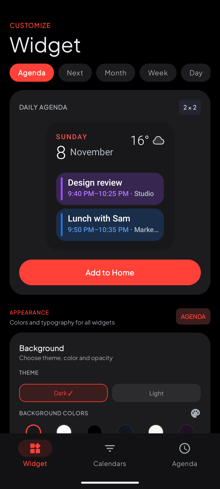
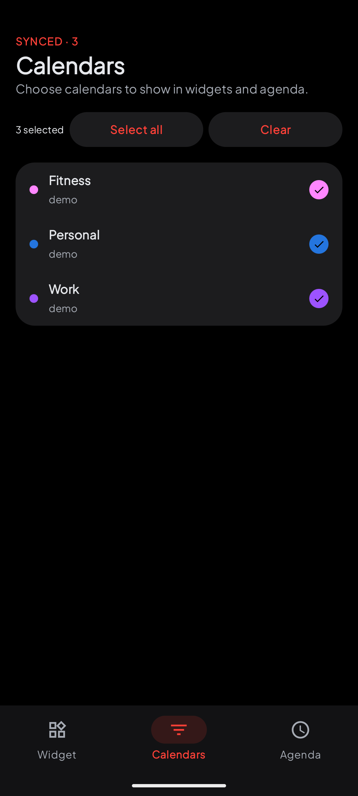
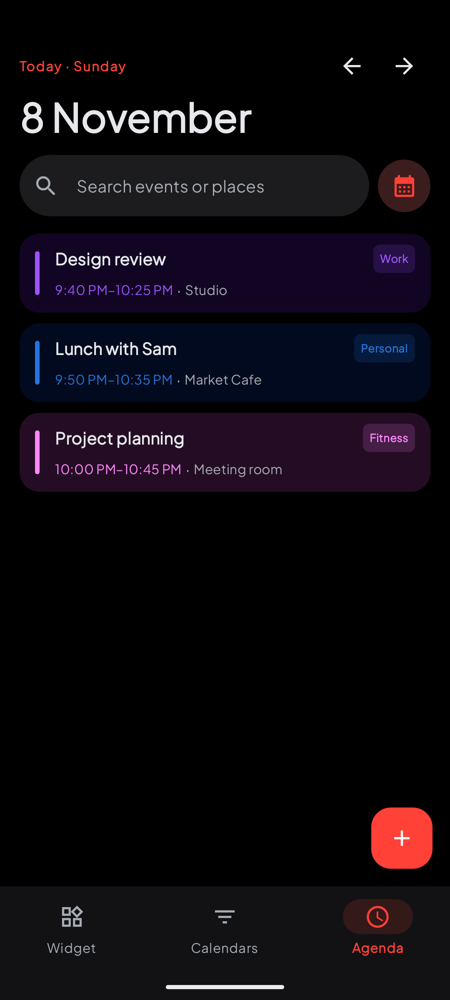
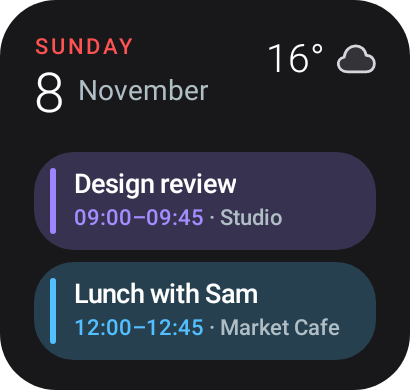
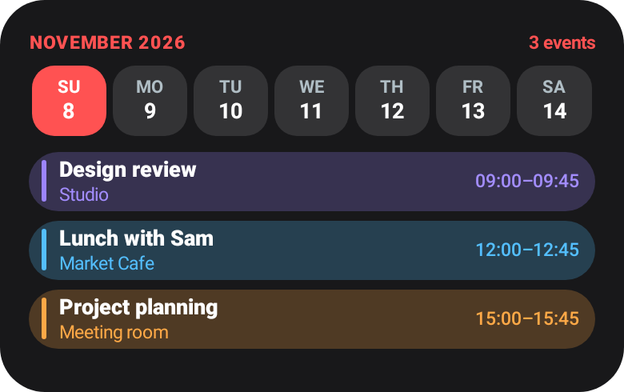
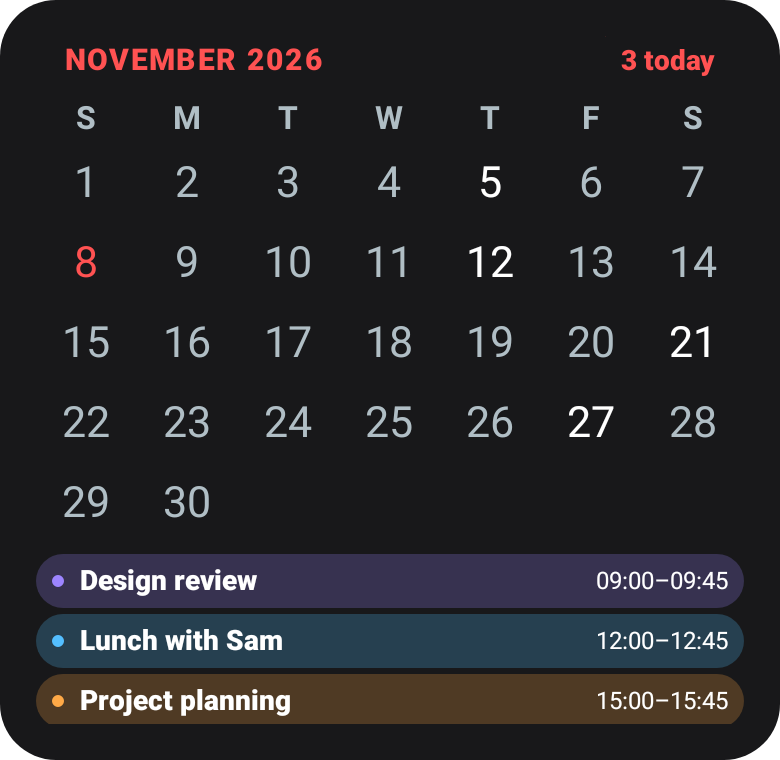
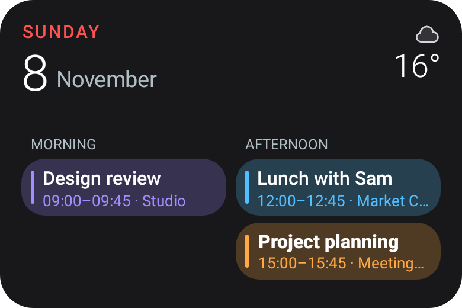
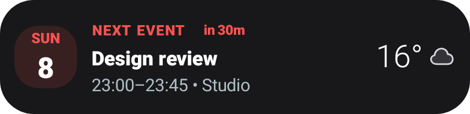

# Useful Calendar Widgets

Useful Calendar Widgets brings your Android calendars to the Home screen. Choose which calendars to show, then customize the widget colors, opacity, text size, and event details.

- **Agenda** shows today's events or the weather when your day is clear.
- **Up Next** highlights the next event, with weather on the right in the 4×1 layout.
- **Week** keeps the days in view while you scroll through the selected day's events on Android 12 and later.
- **Month** combines a calendar grid with events for the selected date.
- **Day** groups events into morning and afternoon.

Weather is optional. Use your device location or choose a city. The launcher icon displays the day of the month.

## App screenshots

Captured from the Android app in an emulator with sample events, three demo calendars, and a fictional weather location.

| Widget settings | Calendars | Agenda |
| --- | --- | --- |
|  |  |  |

## Widget previews

Rendered with the app's Android widget layouts using sample events and simulated weather.

| Agenda | Week |
| --- | --- |
|  |  |

| Month | Day |
| --- | --- |
|  |  |

|Up Next
| --- |
|

## Install

Download the APK from [Release 1.0](../../releases/tag/v1.0). The APK is signed with the project's distribution key and supports Android 7.0 and later. After installing, open the app, grant calendar access, and add a widget from the Widgets tab or your launcher.

If you installed the earlier debug-signed build, uninstall it before installing this APK. Android requires the same signing certificate for in-place updates. You may need to add your widgets and configure them again.

## Languages

The app provides English and Italian resources. Other device languages fall back to English for untranslated interface text. Dates and weekdays follow the device locale, and event times follow the device time zone.

## License

The project source is available for noncommercial use. If you distribute a
project that incorporates this code, publish its corresponding source under
the same terms. See [LICENSE](LICENSE) for details.
